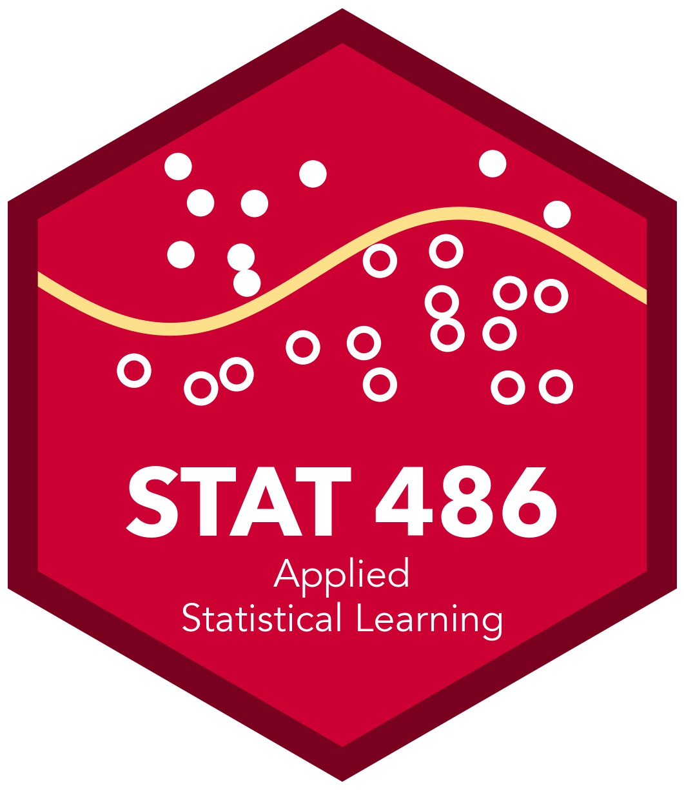
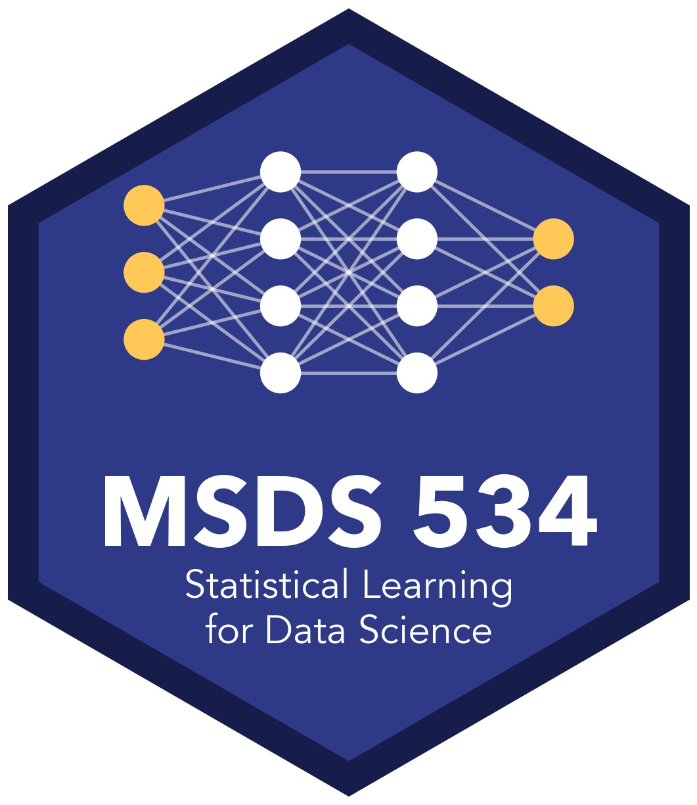
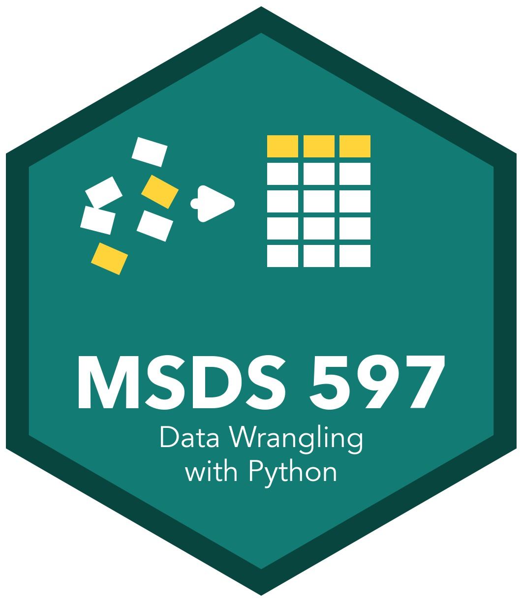

## Undergraduate

### STAT-486: Applied Statistical Learning

::: {.grid}

::: {.g-col-12 .g-col-md-2}

:::

::: {.g-col-12 .g-col-md-10}

[Spring 2026](https://moran-teaching.github.io/stat486-website/)

This class explores modern statistic statistical learning in four major areas: (1) simulation/resampling
based statistical inference, (2) supervised statistical learning, (3) unsupervised statistical learning,
and (4) missing data and causal inference. 

:::

:::

## Masters

### MSDS-534: Statistical Learning for Data Science

::: {.grid}

::: {.g-col-12 .g-col-md-2}

:::

::: {.g-col-12 .g-col-md-10}

[Fall 2025](https://moran-teaching.github.io/msds534-website/), &nbsp; [Fall 2024](https://github.com/gemoran/msds-534-2024), &nbsp; [Fall 2023](https://github.com/gemoran/msds-534-2023)

This class covers the basics of deep learning from a statistical perspective, including feedforward neural networks, convolutional neural networks, recurrent neural networks, transformers, VAEs and diffusion models. Then, we study uncertainty quantification using conformal inference. Finally, we cover hypothesis testing with deep learning. 

:::

:::

### MSDS-597: Data Wrangling with Python

::: {.grid}

::: {.g-col-12 .g-col-md-2}

:::

::: {.g-col-12 .g-col-md-10}

[Spring 2025](https://moran-teaching.github.io/msds597-website/)

This course provides an introduction to the principles and tools to retrieve, "tidy," clean, and
visualize data in preparation for statistical analysis. Principles of reproducibility and reusability are
emphasized. It teaches techniques to wrangle and explore data. 

:::

:::
